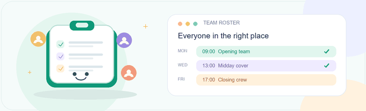
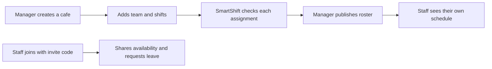

# SmartShift

<p align="center"></p>

**Staff scheduling for cafes and small teams.** Build rosters around skills, availability, weekly hour limits, and leave requests.

   

## 🌷 Is SmartShift ready?

**The core app is ready for a hosted student/demo deployment** once the hosting environment has its MongoDB Atlas settings and production mode configured. Managers can create a cafe, invite staff, build and publish a roster, and review leave requests. Staff can join their cafe, set availability, request leave, and see their own assigned shifts.

It is a prototype, not yet hardened for handling real employee records at business scale. Read [Before a public launch](#before-a-public-launch) before sharing a public URL.

## ☕ The problem it solves

Small hospitality teams often coordinate schedules through spreadsheets and messages. That makes it easy to miss a skill requirement, availability conflict, weekly hour limit, or leave request. SmartShift keeps those details together so a manager can build a roster with fewer manual checks and staff can see the schedule that belongs to them.

## ✨ What you can do

| For managers 🧑‍🍳 | For staff 🌿 |
| --- | --- |
| Create an account for a named cafe or business | Join the right cafe with a manager’s invite code |
| Add team members, skills, weekly hour limits, and pay | Set weekly availability and preferred time blocks |
| Create shifts with a chosen day and start/end time | See only your own assigned shifts |
| Assign staff with skill, availability, and hour checks | Submit leave requests and check their status |
| Review and respond to leave requests | Update your profile details |
| Publish the weekly roster for the team | See workspace changes refresh about every 4 seconds |

### A small, friendly flow



## 🚀 Run it on your computer

### You’ll need

- [Node.js 18 or newer](https://nodejs.org/)
- npm (included with Node.js)
- Optional: a MongoDB Atlas cluster for cloud database storage

### 1. Install the app

Open PowerShell in the project folder and run:

```powershell
npm install
```

### 2. Choose where data is stored

**Quick demo mode:** leave `MONGODB_URI` unset in your environment. SmartShift uses `server/data/db.json` locally.

**Atlas mode:** copy the example settings and fill in your Atlas connection string:

```powershell
Copy-Item .env.example .env
```

Open `.env` and set `MONGODB_URI` and `MONGODB_DB_NAME=smartshift`. In Atlas, allow your current public IP under **Network Access** for local development. Keep `.env` private; it is ignored by Git. The Atlas database user password is separate from your MongoDB website login password.

### 3. Start SmartShift

```powershell
npm start
```

Open **http://localhost:3000** in your browser. If port `3000` is already occupied, run `$env:PORT = "3001"` in PowerShell before `npm start`, then use **http://localhost:3001**.

The terminal prints `DATABASE_MODE=atlas database=smartshift` when Atlas connects, or `DATABASE_MODE=local-json` in local demo mode. The app will stop with a clear connection error if Atlas is configured but unreachable.

## 🪄 First time through

1. Choose **Manager** and create an account with your cafe name.
2. Open your profile and copy the cafe invite code.
3. Add staff from the manager dashboard. Add their email and skills so assignments can be checked.
4. Give the invite code to your team. Staff choose **Staff**, create an account with the same email, and enter the code.
5. Create shifts, assign team members, and publish the roster.
6. Staff can sign in to see their own schedule, set availability, and request leave.

Each manager has a separate cafe workspace. Staff accounts join one workspace through its invite code. A manager sees their own cafe’s team and roster; staff accounts receive their own shifts and leave information.

## 🗂️ Where the data lives

In Atlas, open **Clusters → Browse Collections → `smartshift` → `application_state`**. The current app stores state in one document with `_id: "smartshift"`; cafe workspaces are in its `workspaces` array. User passwords are stored as salted hashes.

In local JSON mode, the same app state is stored in `server/data/db.json`. That file is local runtime data and should not be committed.

## 🧸 Under the hood

```text
SmartShift/
├── assets/          Brand and static assets
├── css/             Responsive page, component, and motion styles
├── js/              Sign-in, API client, manager, staff, and UI behavior
├── server/          Node.js REST API and database connection
├── tests/           API workflow and UI smoke checks
├── index.html       Landing page and application screens
├── .env.example     Safe configuration template
└── package.json     Start and test commands
```

The browser app talks to the same Node.js server that serves the API. The server stores data in MongoDB Atlas when `MONGODB_URI` is configured, otherwise it uses local JSON storage. Workspace screens refresh in the background about every four seconds while signed in.

## 🧪 Check the project

```powershell
npm test
```

The automated checks cover role-based sign-in, cafe workspace separation, staff-only schedule access, shift assignment safeguards, and essential UI screens.

## 🔐 Before a public launch

- Set up a hosting provider and add the database settings as private environment variables.
- Use a strong, unique Atlas database password and restrict Atlas network access to the hosting provider where possible.
- Pick a hosting/database plan that fits your expected usage; free plan limits can change.
- The current refresh is periodic (about four seconds), rather than push-based live updates.
- Login sessions live in the running server’s memory, so a restart signs everyone out; this setup is intended for one app instance.
- The app stores its state in one MongoDB document. It is suitable for a class demo, not high-concurrency business use.
- Add login rate limiting and a persistent session store before treating this as a production service.
- This is a student project prototype. Review production hosting, privacy, backups, and operational needs before using it for real employee records.

## 🌼 Configuration

| Setting | What it does |
| --- | --- |
| `MONGODB_URI` | Atlas connection string; leave unset for local JSON mode |
| `MONGODB_DB_NAME` | Atlas database name; defaults to `smartshift` |
| `MONGODB_DNS_SERVERS` | DNS resolver used for Atlas lookup; defaults to `8.8.8.8` |
| `PORT` | Server port; defaults to `3000` |
| `NODE_ENV` | Set to `production` on your hosting provider |
| `CLIENT_ORIGIN` | Optional allowed origin when the frontend is hosted separately |

For a hosted demo, set `NODE_ENV=production` and provide `MONGODB_URI` and `MONGODB_DB_NAME` as private environment settings. Never commit `.env` or publish database credentials.

## 📜 License

MIT. See [LICENSE](LICENSE).
