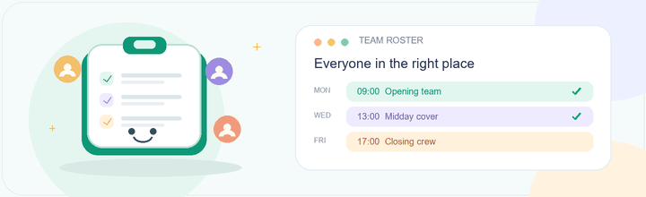
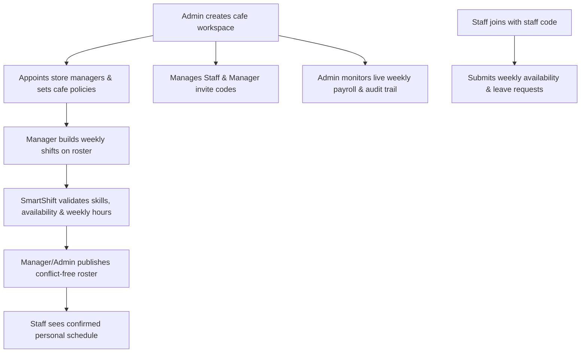

# SmartShift

<p align="center"><strong>Good shifts. Happier teams.</strong><br />A people-first roster planner for restaurants and small businesses.</p>

<p align="center">
  <a href="https://smartshift-pzj2.onrender.com"></a>
  &nbsp; 
</p>

<p align="center"></p>

   

## 💚 Try the live app

**[Launch SmartShift →](https://smartshift-pzj2.onrender.com)**

The app is hosted on Render’s free plan, so the first visit after a quiet period can take around 50 seconds while it wakes up. This is a student project preview, not a production service for real employee records.

## 🧭 The idea

Small businesses and restaurants often plan shifts in spreadsheets and messages. SmartShift brings staff skills, availability, weekly hour limits, and leave requests into one place, helping managers plan with fewer manual checks while giving each staff member a clear view of their own schedule.

## ✨ What you can do

| For Cafe Admins / Owners 👑 | For Store Managers 🛡️ | For Staff 🌿 |
| --- | --- | --- |
| Create and administer the cafe / restaurant workspace | Plan weekly shifts and specify required roles | Join the cafe with the staff invite code |
| Appoint and oversee both managers and staff | Smart validation: skills, availability, and weekly hours | Set weekly availability and preferred time blocks |
| Set cafe operating policies (max hours cap, base rates) | Review and respond to leave requests | See only your own confirmed shifts |
| Manage separate Staff & Manager invite codes | Publish the weekly roster for the team | Submit leave requests and track leave balance |
| Track estimated payroll costs and cafe activity trail | Open the shift assignment matrix | Update profile details and skills |

### Cafe & Business Owner Administration

Every cafe, restaurant, or small business gets its own isolated workspace with a multi-tier role-based access model:
- **Admin (Cafe Owner / Business Administrator):** Holds executive authority over that specific cafe or business. The admin supervises both store managers and staff members, appoints managers, sets cafe operating rules (max weekly hours cap, base pay rates), manages and regenerates dual invite codes, monitors weekly payroll costs, and retains supervisory oversight to inspect shift rosters and leave requests.
- **Manager (Shift Supervisor / Store Planner):** Coordinates day-to-day operations: creating shifts, assigning workers using the Smart 3-Rule Validation Engine (skills, availability, overtime), reviewing time-off requests, and publishing the weekly roster.
- **Staff (Employees / Team Members):** Submits weekly availability (available, preferred, unavailable), views confirmed personal shifts, and requests time off.

### Multi-tier workflow



## 🚀 Run it on your computer

### You’ll need

- [Node.js 18 or newer](https://nodejs.org/)
- npm (included with Node.js)
- Optional: a MongoDB Atlas cluster for cloud database storage

### 1. Install the app

Open PowerShell in the project folder and run:

```powershell
npm install
```

### 2. Choose where data is stored

**Quick demo mode:** leave `MONGODB_URI` unset in your environment. SmartShift uses `server/data/db.json` locally.

**Atlas mode:** copy the example settings and fill in your Atlas connection string:

```powershell
Copy-Item .env.example .env
```

Open `.env` and set `MONGODB_URI` and `MONGODB_DB_NAME=smartshift`. In Atlas, allow your current public IP under **Network Access** for local development. Keep `.env` private; it is ignored by Git. The Atlas database user password is separate from your MongoDB website login password.

### 3. Start SmartShift

```powershell
npm start
```

Open **http://localhost:3000** in your browser. If port `3000` is already occupied, run `$env:PORT = "3001"` in PowerShell before `npm start`, then use **http://localhost:3001**.

The terminal prints `DATABASE_MODE=atlas database=smartshift` when Atlas connects, or `DATABASE_MODE=local-json` in local demo mode. The app will stop with a clear connection error if Atlas is configured but unreachable.

## 🌐 Deploy a free demo on Render

The [live preview](https://smartshift-pzj2.onrender.com) is deployed from this repository using the Render Blueprint in `render.yaml`. It runs the Node.js app as one web service and stores app data in MongoDB Atlas. The Atlas connection string is kept in Render’s private environment settings, not in the repository.

To create a separate copy, choose **New → Blueprint** in Render, connect this GitHub repository, and provide `MONGODB_URI` privately when prompted. The Blueprint sets production mode, uses the Atlas database, and checks `/api/health` after starting. Render’s outbound IP ranges can be found under **Connect → Outbound** and added to Atlas **Network Access**. The health endpoint should report `"database":"atlas"` when the database connection is working.

Render’s free web services sleep after 15 minutes without traffic and may take about a minute to wake. Their local files are temporary, so keep `MONGODB_URI` configured to use Atlas for persistent app data. See [Render’s free service limits](https://render.com/docs/free) and [outbound IP guide](https://render.com/docs/outbound-ip-addresses).

## 🪄 Quick demo accounts & first time through

SmartShift comes with pre-configured demo credentials for all three cafe tiers:

| Role | Email | Password | What to try |
| --- | --- | --- | --- |
| **Cafe Admin 👑** | `admin@smartshift.local` | `admin123` | View total payroll, invite/appoint managers, set cafe operating policies, oversee team |
| **Store Manager 🛡️** | `manager@smartshift.local` | `manager123` | Build shifts, assign team members with smart checks, review leave requests, publish roster |
| **Staff Member 👨‍🍳** | `alex.rivera@smartshift.com` | `employee123` | Check confirmed shifts, cycle availability (Available / Preferred / Unavailable), request leave |

### Step-by-step first walk-through:

1. **Admin Setup**: Log in as **Admin** (or sign up choosing Admin). Review the Cafe Administration Console, see the Staff Invite Code and Manager Invite Code, and appoint store managers.
2. **Manager Flow**: Log in as **Manager**. Create shifts, assign team members (SmartShift validates certification, availability, and weekly hours in real-time), and publish the weekly roster.
3. **Staff Flow**: Log in as **Staff**. Set weekly availability, submit a time-off request, and view your assigned schedule.
4. **Supervisory Oversight**: Log back into Admin to see live estimated payroll analytics and the complete audit trail.

## 🗂️ Where the data lives

In Atlas, open **Clusters → Browse Collections → `smartshift` → `application_state`**. The current app stores state in one document with `_id: "smartshift"`; cafe workspaces are in its `workspaces` array. User passwords are stored as salted hashes.

In local JSON mode, the same app state is stored in `server/data/db.json`. That file is local runtime data and should not be committed.

## 🧸 Under the hood

```text
SmartShift/
├── assets/          Brand and static assets
├── css/             Responsive page, component, manager, employee, and admin styles
├── js/              Sign-in, API client, admin, manager, staff, and UI behavior
├── server/          Node.js REST API and database connection
├── tests/           API workflow, admin governance, and UI smoke checks
├── render.yaml      Free Render service configuration
├── index.html       Landing page and application screens
├── .env.example     Safe configuration template
└── package.json     Start and test commands
```

The browser app talks to the same Node.js server that serves the API. The server stores data in MongoDB Atlas when `MONGODB_URI` is configured, otherwise it uses local JSON storage. Workspace screens refresh in the background about every four seconds while signed in.

## 🧪 Check the project

```powershell
npm test
```

The automated checks cover multi-tier role authentication (Admin, Manager, Staff), cafe workspace separation, staff-only schedule access, shift assignment safeguards (skills, availability, overtime), and admin governance controls (manager appointment, code regeneration, policy updates).

## 🔐 Before a public launch

- Set up a hosting provider and add the database settings as private environment variables.
- Use a strong, unique Atlas database password and restrict Atlas network access to the hosting provider where possible.
- Pick a hosting/database plan that fits your expected usage; free plan limits can change.
- The current refresh is periodic (about four seconds), rather than push-based live updates.
- Login sessions live in the running server’s memory, so a restart signs everyone out; this setup is intended for one app instance.
- The app stores its state in one MongoDB document. It is suitable for a class demo, not high-concurrency business use.
- Add login rate limiting and a persistent session store before treating this as a production service.
- This is a student project prototype. Review production hosting, privacy, backups, and operational needs before using it for real employee records.

## 🌼 Configuration

| Setting | What it does |
| --- | --- |
| `MONGODB_URI` | Atlas connection string; leave unset for local JSON mode |
| `MONGODB_DB_NAME` | Atlas database name; defaults to `smartshift` |
| `MONGODB_DNS_SERVERS` | DNS resolver used for Atlas lookup; defaults to `8.8.8.8` |
| `PORT` | Server port; defaults to `3000` |
| `NODE_ENV` | Set to `production` on your hosting provider |
| `CLIENT_ORIGIN` | Optional allowed origin when the frontend is hosted separately |

For a hosted demo, set `NODE_ENV=production` and provide `MONGODB_URI` and `MONGODB_DB_NAME` as private environment settings. Never commit `.env` or publish database credentials.

## 📜 License

MIT. See [LICENSE](LICENSE).
